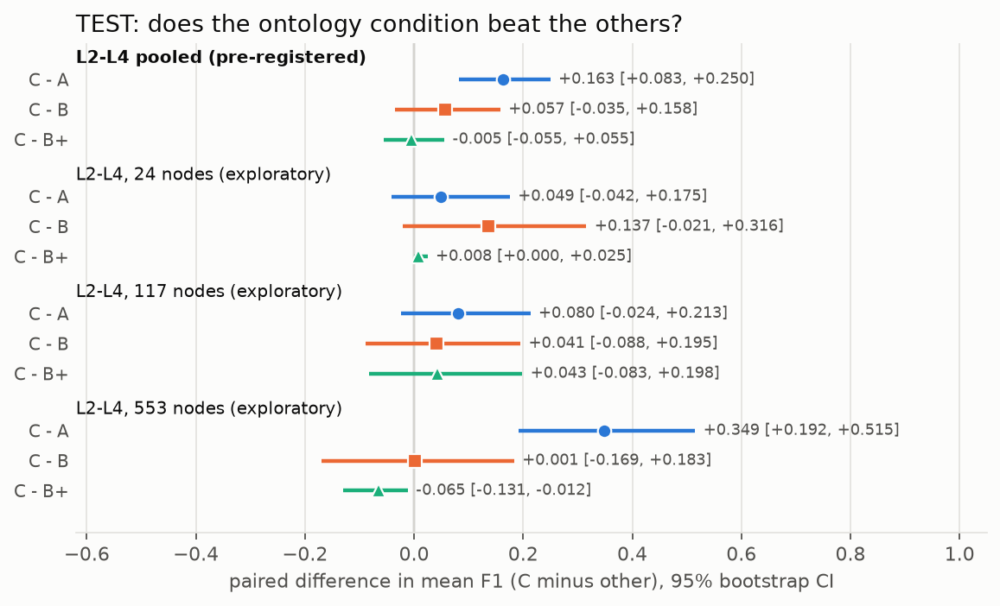

# Blast Radius: do ontologies help LLMs reason about system topology?

A series of small, pre-registered benchmarks testing one thesis:

> "LLMs grounded in an ontology are better at reasoning about system topology than LLMs alone."

Each experiment fixes its hypotheses, analysis and decision rules in a pre-registration committed before any TEST
question is sent to the model, and reports its results whether or not they support the thesis.

## Results so far

| | Question | Pre-registered result | Status |
|---|---|---|---|
| **[Experiment 1](exp1/README.md)** | Does an ontology (RDF + RDFS/OWL schema, queried with SPARQL) beat an LLM alone, and beat Python code given the same schema documentation? | C − B+ = **−0.005** [−0.055, +0.055]: **not supported**. Ontology and documented code tie; both beat the LLM alone (C − A = +0.163 [+0.083, +0.250]) | complete, tag `exp1-final` |
| **[Experiment 2](exp2/README.md)** | Do *executable* definitions encoded in an ontology (rule-defined classes, materialized before querying) beat the same definitions written as prose? | C2 − B+ = **+0.026** [0.000, +0.071]: **not supported**. Ontology rules and equivalent Python helpers tie exactly (C2 − B++ = 0.000, as predicted) | complete, tag `exp2-final` |
| **[Experiment 3](exp3/PREREG_EXP3.md)** | Do ontologies pay off with two sources that name the same entities differently (H1), and when definitions change over time (H2)? | not run yet | design pre-registered as a draft; data, ground truth and questions built |

All differences are mean paired F1 differences on the pre-registered question set, with 95% bootstrap confidence
intervals.

## The story

1. **Experiment 1** compared four conditions on synthetic infrastructure graphs (24 to 553 nodes): the LLM alone with
   the graph in its prompt (A), Python over raw JSON (B), Python plus prose schema documentation (B+), and SPARQL over
   an RDF graph with an RDFS/OWL schema (C). Grounding of either kind clearly beat the LLM alone, and the gap grew with
   graph size. Ontology and documented code tied. C's errors concentrated on region-failure questions, where it had to
   derive "every member of the replica group is in the failed region" by hand in SPARQL.
2. **Diagnosis ([exp1/ADDENDUM.md](exp1/ADDENDUM.md)).** Experiment 1's ontology was a thin typed graph: the concepts
   the hard questions depend on (replica group, footprint, lost, down) lived only in prose in the question text. The
   tie partly reflects how little the ontology was asked to do.
3. **Experiment 2** made the definitions executable: an ontology whose rules materialize `Primary`, `Lost`, `Down` and
   `BreachedSLA` before the model queries it (C2), against the same definitions as prose (B+) and as Python helpers
   (B++). Both executable forms removed the prose condition's only error type (applying "primary" in the wrong
   direction), but prose was already at 0.974 F1, so the pre-registered test could not separate them: the ceiling
   effect flagged in advance. The ontology added nothing over equivalent Python.
4. **Experiment 3** moves to the settings where ontologies are usually argued to pay off: two exports (CMDB-style and
   monitoring-style) with conflicting IDs, aliases, stale records and contradictions, and a pre-specified schema and
   definition change. The headroom is controlled in the generator and checked by a pilot before any TEST run.



The [research notebook](notebook/blast_radius.ipynb) walks through Experiments 1 and 2 with all figures, computed live
from the committed results.

## Repository layout

```
exp1/                    Experiment 1 (frozen): ontology vs code vs LLM alone
  README.md              write-up        PREREG.md        pre-registration     PROMPT_LOG.md   tuning log
  ADDENDUM.md            post-freeze note on what the ontology was asked to do
  gen.py truth.py questions.py llm.py sandbox.py common.py run_*.py score.py plots.py schema.ttl
  data/ results/         graphs, questions, answer key; raw responses, scores, figures
exp2/                    Experiment 2 (frozen): executable definitions, ontology rules vs Python helpers vs prose
  README.md PREREG_EXP2.md LOG.md EFFORT.md
  gen2.py helpers.py rules.py ontology2.ttl docs.py questions2.py run2.py score2.py + checks
  data/ results/
exp3/                    Experiment 3 (in progress): two conflicting sources, changing definitions
  PREREG_EXP3.md (draft) gen3.py truth3.py questions3.py
  data/                  cmdb_*.json, monitoring_*.json, questions.json
  data/hidden/           canonical graphs, entity-resolution keys, answer key (never shown to any condition)
notebook/                research notebook across experiments
tools/                   verify_frozen.py, run_exp2_check_docs.py
pyproject.toml           dependencies; makes exp1's shared modules importable everywhere
CLAUDE.md                standing rules for automated work on this repo
```

Experiments 2 and 3 reuse Experiment 1's modules (`truth`, `llm`, `sandbox`, `score`, ...) unmodified;
`pip install -e .` puts `exp1/` on the import path.

## Setup and reproduce

```
python -m venv .venv
.venv/Scripts/pip install -e ".[notebook]"      # Windows; use .venv/bin on Unix
export ANTHROPIC_API_KEY=...                     # only needed for new model calls

python tools/verify_frozen.py                    # every pre-registered file hash, exp1 and exp2
python exp1/test_score.py                        # exp1 scorer tests
python exp1/test_harness.py                      # exp1 offline harness tests (no API calls)
python exp2/verify_defs.py                       # exp2 helpers and rules reproduce ground truth
python tools/run_exp2_check_docs.py              # exp2 definitions present in every condition's docs
python exp2/test_run2.py                         # exp2 offline harness tests
python exp3/truth3.py                            # exp3 exports consistent with the hidden canonical graph

python exp1/score.py test                        # exp1 tables and the paired bootstrap
python exp2/score2.py test                       # exp2 cluster and per-question bootstraps
```

Every model call is cached on disk (`exp1/cache/`, git-ignored), keyed by condition, model, prompt and token limit,
so re-runs of completed experiments cost nothing. Raw responses for every question are in each experiment's
`results/`.

## Integrity

- **Pre-registration before TEST:** `exp1/PREREG.md` and `exp2/PREREG_EXP2.md` were committed before their TEST runs
  and list file hashes; `tools/verify_frozen.py` checks them. The hashes were taken on Windows, where Git may rewrite
  line endings on checkout, so the checker also accepts the LF and CRLF forms of each file and reports which matched.
- **Frozen tags:** `exp1-final` and `exp2-final` mark each experiment exactly as reported.
- **Logged changes:** every prompt, question, harness and post-run change is logged with its reason
  (`exp1/PROMPT_LOG.md`, `exp2/LOG.md`). The one change to frozen material, moving Experiment 1 into `exp1/` on
  2026-10-19 with no content change, is logged in `CLAUDE.md`.
- **Model and cost:** Haiku 4.5 at temperature 0 throughout. Spend so far: Experiment 1 $3.08, Experiment 2 $0.84,
  Experiment 3 $0.

## Limitations that apply to every experiment

Synthetic graphs from one generator; one model and one run per question; the same author wrote the generator,
questions, ground truth and every artifact the conditions use; small per-cell counts make subgroup results
exploratory. Each write-up lists its own limitations in full.
