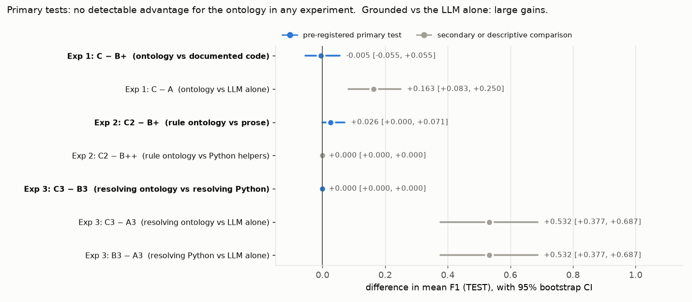

# Blast Radius: do ontologies help AI reason about how systems depend on each other?

## TL;DR

Three pre-registered experiments tested whether an AI model answers infrastructure questions better when it works
from an ontology than from the same knowledge in other forms. In every head-to-head test, the ontology tied with
ordinary code carrying the same knowledge. What made the difference was the work done before the AI saw anything:

1. **Resolving entities across sources.** With two conflicting sources, the AI alone scored 0.47; once the sources were
   resolved for it, by Python or by an ontology, it scored 1.00 (Experiment 3).
2. **Precomputing definitions.** Turning definitions like "down" and "lost" into ready-made lookups removed the
   remaining errors: 0.97 → 1.00, using about a fifth of the text and a quarter of the time (Experiment 2).
3. **Where failures get caught.** When a data field was renamed, the ontology failed loudly, while the AI patched
   around the same failure in the Python setup and gave 18 of 53 answers that looked normal but were wrong
   (Experiment 3, exploratory).

Read more: [research notebook](notebook/blast_radius.ipynb) ·
[Experiment 1](exp1/README.md) · [Experiment 2](exp2/README.md) · [Experiment 3](exp3/README.md) ·
[consolidated report](REPORT.md)



*Each experiment's comparisons, recomputed from the committed results by `tools/summary_figure.py`. Bold rows are
the pre-registered primary tests.*

### All results at a glance

| | Question | Pre-registered result | Caveat | Status |
|---|---|---|---|---|
| **[Experiment 1](exp1/README.md)** | Does an ontology (RDF + RDFS/OWL schema, queried with SPARQL) beat an LLM alone, and beat Python code given the same schema documentation? | C − B+ = **−0.005** [−0.055, +0.055]: **not supported**. Ontology and documented code tie; both beat the LLM alone (C − A = +0.163 [+0.083, +0.250]) | The ontology arm's failures may partly reflect lower model fluency in SPARQL than in Python (see below) | complete, tag `exp1-final` |
| **[Experiment 2](exp2/README.md)** | Do *executable* definitions encoded in an ontology (rule-defined classes, materialized before querying) beat the same definitions written as prose? | C2 − B+ = **+0.026** [0.000, +0.071]: **not supported**. Ontology rules and equivalent Python helpers tie exactly (C2 − B++ = 0.000, as predicted) | Ceiling: prose scored 0.97 and both encoded forms 1.00, so little room was left to show a difference | complete, tag `exp2-final` |
| **[Experiment 3](exp3/README.md)** | Do ontologies pay off with two sources that name the same entities differently (H1), and when definitions change over time (H2)? | C3 − B3 = **0.000** [0.000, 0.000]: **not supported**, both perfect, as expected on ceiling grounds. Both beat the LLM alone (B3 − A3 = C3 − A3 = +0.532 [+0.377, +0.687], two smaller graphs). H2 (exploratory): unchanged C3 broke loudly on all 53 questions, unchanged B3 silently on 18; after 4 changed code lines each, B3 0.981, C3 1.000 | Ceiling: both resolving setups were perfect, so the test could not have shown a difference either way. H2 is two changes, tried once each | complete |

All differences are mean paired F1 differences on the pre-registered exam questions, with 95% bootstrap confidence
intervals. The condition codes (A, B, B+, C, ...) are explained in the [legend](#condition-codes).

---

## Why this question

When a datacenter goes down at a large company, someone has to answer a hard question fast: *what else breaks?*
Which services stop working, which customers are affected, which contracts are breached? This is called the
**blast radius** of a failure, and answering it means following chains of dependencies across hundreds of systems.

Companies increasingly want AI assistants, built on large language models (the kind of AI behind assistants like
ChatGPT or Claude), to answer questions like this. A popular claim is that these assistants work much better if they
are given an **ontology**: a formal, machine-readable description of what exists in the business and how it all
connects. <!-- TODO: add 2-3 citations to sources making this claim (vendor, practitioner or research). --> Ontologies
are expensive to build, so it matters whether the claim is true.

This repository is a series of small, carefully controlled experiments that test it:

> "AI models grounded in an ontology are better at reasoning about how systems depend on each other than AI models alone."

Short answer: **when the ontology and Python code carried the same resolved facts and the same definitions, they
performed identically.** In Experiments 2 and 3 both reached near-ceiling scores, so those tests could not have shown a
difference either way. What clearly helped was the work an ontology is supposed to do, resolving what things are and
computing what they mean before the AI is asked, whichever technology does it. The rest of this page explains how I
tested that, what I found, and what I think it means.

---

## Contents

1. [Key ideas in plain words](#key-ideas-in-plain-words)
2. [How the experiments work](#how-the-experiments-work)
3. [What I found, experiment by experiment](#what-i-found-experiment-by-experiment)
4. [What this means for ontologies](#what-this-means-for-ontologies)
5. [What these experiments cannot tell you](#what-these-experiments-cannot-tell-you)
6. [Related work](#related-work)
7. [Future work](#future-work)
8. [Glossary](#glossary)
9. [For technical readers](#for-technical-readers)

---

## Key ideas in plain words

**Large language model (LLM).** The kind of AI behind chat assistants. It reads text and writes text. It is very
good with language, but it can make mistakes when it has to keep track of many precise facts at once, such as a long
list of which system depends on which. All experiments here use one model, Anthropic's Haiku 4.5
(`claude-haiku-4-5-20251001`), run at temperature 0, which makes answers nearly deterministic; every response is also
cached.

**Infrastructure as a map.** A company's technology looks like a map of connected points: *services* (the software
that does the work, like a checkout service), *databases* (where data is stored), *teams* that own them, *regions*
(the datacenters where they run), and *SLAs* (contracts promising a level of availability to customers). Arrows show
what depends on what. If the checkout service needs the payments database, and the payments database runs only in a
datacenter in Frankfurt, then a Frankfurt outage takes checkout down too, even if checkout itself runs elsewhere.
Many services also have **replicas**, backup copies in another region, which can keep them alive when one region fails.

**Ontology.** Think of it as a combination of a dictionary and a rulebook for a business, written so that a computer
can use it. It says what kinds of things exist ("a customer-facing service is a kind of service"), how they relate
("a service depends on a database"), and sometimes rules for working things out ("a service is down if anything it
depends on is down"). Ontologies are usually written in special standard languages (RDF and OWL) and questioned
with a matching query language (SPARQL).

**Grounding.** Giving an AI real, structured information to work from instead of asking it to rely on memory or on a
wall of pasted text.

**The question being tested.** If I give the AI the same knowledge in different forms (raw data, data plus a manual,
data plus ready-made code, or a formal ontology), does the ontology form produce better answers?

---

## How the experiments work

### A made-up company with known answers

Each experiment builds a fictional company's infrastructure from scratch, at three sizes: about 24, 120 and 550
connected items. Because I generate it myself, I know the correct answer to every question exactly, computed by a
separate program that never shares code with the AI setups being tested. I also plant tricky cases on purpose: a
database that fails deep inside a chain of dependencies, a service that survives only because of its backup copy, rule
violations hidden in the data.

### The questions

The AI is asked questions like:

- "Which team owns the payments service?" (simple lookup)
- "Which services depend, directly or indirectly, on database X?" (following chains)
- "If the Frankfurt datacenter fails, which customer contracts (SLAs) are breached?" (failure analysis)
- "Which services break the rule that critical services must not depend on low-priority ones?" (rule checking)

Each answer is a list of names, a yes/no, or a number, so it can be graded automatically.

### The setups being compared

Each experiment gives the same AI the same questions about the same company, but with different help. Roughly:

| Setup | What the AI gets | Everyday comparison |
|---|---|---|
| **AI alone** (A, A3) | the whole map pasted into its instructions | memorizing a city map and answering from memory |
| **AI + code** (B) | the data files and the ability to write and run a small program | being handed the map and a calculator |
| **AI + code + manual** (B+) | the same, plus a written description of what everything means | the map, a calculator and a guidebook |
| **AI + ready-made tools** (B++, B3) | the same, plus pre-written functions that already compute things like "what is down" | a navigation app that already knows the routes |
| **AI + ontology** (C, C2, C3) | a formal ontology describing everything, which it questions with SPARQL | a professionally built atlas with an index and rules |

#### Condition codes

| Code | Experiment | Description |
|---|---|---|
| **A** | 1 | AI alone: the whole graph in the prompt |
| **B** | 1 | AI + code: Python over the raw data |
| **B+** | 1, 2 | AI + code + manual: Python plus a prose description (in Experiment 2, the prose carries the definitions) |
| **C** | 1 | AI + ontology: one SPARQL query against an RDF graph with an RDFS/OWL schema |
| **B++** | 2 | AI + ready-made tools: B+ plus Python helper functions implementing every definition |
| **C2** | 2 | AI + ontology with rules: definitions computed in advance by SPARQL rules, then one SPARQL query |
| **A3** | 3 | AI alone, reading both raw, conflicting sources |
| **B3** | 3 | AI + ready-made tools: Python glue that resolves both sources and implements every definition |
| **C3** | 3 | AI + ontology: both sources resolved into one RDF graph with rules, then one SPARQL query |

### How answers are scored

Each answer gets a score from **0 to 1** (called **F1**). For a list answer, it balances two things: did the AI
include every correct item, and did it avoid adding wrong ones? A perfect answer scores 1. An answer that finds half
the right items and nothing wrong scores about 0.67. A yes/no or number is either right (1) or wrong (0). The scores
reported are averages over many questions.

### How I kept it fair

Testing AI is easy to fool yourself with: you can keep adjusting things until your favourite setup wins. To avoid
that, every experiment follows the same discipline, borrowed from clinical research:

- **Practice questions and exam questions.** Questions are split in advance into a practice set (DEV), which I may use
  to fix genuine bugs, and an exam set (TEST), which no setup sees until the very end and which is run once.
- **Rules written down before the exam.** Before any exam question is run, I write down and lock (*pre-register*) the
  exact comparison, how it will be calculated, and what result would count as supporting or contradicting the claim.
  Every locked file is fingerprinted, so any later change would be detectable.
- **Same budget for everyone.** Every setup gets the same AI model, the same instructions about answer format, and
  the same number of retries if its program crashes.
- **Honest uncertainty.** Each comparison comes with a **95% confidence interval**, a range of plausible values for
  the true difference. If the range includes zero, the experiment cannot tell the setups apart.
- **Report everything.** Results are published whether or not they support the claim. Every change made along the
  way is logged with its reason.

---

## What I found, experiment by experiment

The pre-registered numbers are in the [table above](#all-results-at-a-glance); this section explains them.

### Experiment 1: does an ontology beat plain data and code?

**Setup.** Four setups: AI alone (A), AI + code (B), AI + code + manual (B+), and AI + ontology (C). The key
comparison was the ontology (C) against code + manual (B+), because both had the same knowledge; only the form
differed.

**Results** (exam set, average score on the reasoning questions):

| AI alone (A) | AI + code (B) | AI + code + manual (B+) | AI + ontology (C) |
|---|---|---|---|
| 0.77 | 0.88 | 0.94 | 0.94 |

- **Organized data plus a tool beat memory, by a lot, and more so as the company grew.** On the largest company,
  the AI alone (A) scored 0.54 while the ontology setup (C) scored 0.89.
- **The ontology (C) tied with code plus a manual (B+)**: essentially zero difference, so by the rules I wrote in
  advance the claim was **not supported**.
- **Where the ontology setup struggled:** failure questions. To answer "is this database lost if Frankfurt fails?",
  the AI had to write a query meaning "*every* backup copy of it is in Frankfurt". It wrote that logic wrong in 9 of
  12 such questions, most often checking one copy instead of all of them. On questions that needed path lengths or
  path counts, it scored 0.44 while the code setups scored 0.89-1.00.
- **Caveat:** these SPARQL failures may reflect the model being less fluent in SPARQL than in Python, and SPARQL
  property paths cannot count hops. That is a query-language and training-data confound, not necessarily a property
  of ontologies.

**My diagnosis afterwards.** The ontology in Experiment 1 was thin. It described what kinds of things existed, but
the hard ideas, like "lost" and "down", were only explained in words inside each question. So the experiment really
compared "a query language plus a description" against "code plus the same description". It never gave the ontology
the job that ontologies are meant to do. That shaped Experiment 2. Details: [Experiment 1 write-up](exp1/README.md),
[addendum](exp1/ADDENDUM.md).

### Experiment 2: what if the ontology does the reasoning in advance?

**Setup.** This time the ontology came with **rules** that work out "lost", "down", "breached" and "primary" for
every item in advance, so the AI only had to look the answers up (C2). It was compared with two setups holding the
exact same definitions: written as a manual (B+), and written as ready-made Python functions (B++).

**Results** (exam set, failure and rule-checking questions):

| Definitions as a manual (B+) | Definitions as Python functions (B++) | Definitions as ontology rules (C2) |
|---|---|---|
| 0.97 | 1.00 | 1.00 |

- **Doing the reasoning in advance removed the remaining mistakes.** The manual-only setup (B+) got 2 of 51 questions
  wrong, both from misreading what "primary" means. Both pre-computed setups got everything right, and they answered
  with about a fifth of the text and in about a quarter of the time.
- **But the ontology (C2) was no better than the equivalent Python (B++).** Both scored a perfect 1.00. The ontology's
  advantage over the manual was too small to rule out zero, so the claim was again **not supported**.
- **Caveat: the test hit a ceiling.** I predicted this beforehand: when even the weakest setup scores 0.97 and the
  other two score 1.00, there is little room left to show a difference, so this tie says nothing about harder
  questions. Details: [Experiment 2 write-up](exp2/README.md).

### Experiment 3: the situation ontologies are made for

**Setup.** Real companies rarely have one clean list of their systems. They have several systems that each keep
their own records and disagree. Experiment 3 recreates that with two sources describing the same infrastructure:

- an **asset inventory** (a CMDB) that calls a service `CI-04821` with the name `payments_search_svc`;
- a **monitoring system** that calls the same service `mon:payments-search`, "Payments Search Service" or
  `pay-sea-svc-v2`.

The two sources also contain deliberate problems: some records describe systems that were shut down long ago, and
some facts contradict each other (one source says a service runs in Frankfurt, the other says Singapore). A fixed
rulebook says which source to trust for which kind of fact. Three setups answered the questions: the AI alone reading
both raw sources (A3), the AI with Python glue code that resolves the conflicts (B3), and the AI with an ontology
that resolves the same conflicts (C3). Each exam question was asked three times.

Two hypotheses were tested separately:

- **H1 (accuracy):** with two disagreeing sources, does an ontology that resolves the conflicts beat Python code that
  resolves the same conflicts?
- **H2 (maintenance):** when the business changes (a field is renamed in one source, and the definition of "lost" is
  changed), does the ontology need fewer edits and cause fewer silent errors than the code?

**Results** (exam set, questions that need both sources):

| AI alone, reading both raw sources (A3) | AI + Python glue that resolves the conflicts (B3) | AI + ontology that resolves the conflicts (C3) |
|---|---|---|
| 0.47 (two smaller companies only) | 1.00 | 1.00 |

The AI alone (A3) was run on the two smaller companies only, as pre-registered.
<!-- TODO: state why A3 was limited to the two smaller graphs. No reason is recorded in exp3/PREREG_EXP3.md,
exp3/LOG3.md or exp3/README.md; do not assume context length without checking. -->

- **The ontology (C3) tied with the Python glue (B3): both were perfect**, so by the rules I wrote in advance H1 was
  **not supported**. **Caveat: this is a ceiling**, and I expected it before the exam: in the practice round both
  setups were already near perfect, and making the sources messier could not change that, because the resolving
  happens before the AI is involved. The test could not have shown a difference either way.
- **Resolving the sources first is what made the difference.** On the two smaller companies, either form of resolved
  knowledge beat the AI alone by +0.53 (confidence range +0.38 to +0.69). Half of the AI's own mistakes matched a
  specific integration error, such as ignoring the monitoring system or trusting the wrong source.
- **The ontology took more code to build:** 201 lines of conversion, rules and schema against 83 lines of Python, for
  the same behaviour.

**What happened when things changed (H2, exploratory: two changes, tried once each).**

- **Before any fix, the two setups broke differently.** The ontology (C3) could not even be built from the renamed
  data, so it failed loudly on every question. The Python setup (B3) also crashed at first, but on its retry the AI
  often patched the data itself and carried on, using the old definition of "lost": 18 of the 53 answers came back
  looking normal but wrong. Of the other 35, 28 still crashed and gave no answer, and 7 were correct. A silent wrong
  answer is worse than a crash, because nobody knows to fix it.
- **That difference comes from where the check runs, not from the ontology.** The ontology was built before the AI saw
  anything, so the AI had no chance to work around the failure. A one-line check of the data in the Python setup,
  run at the same point, would do the same. I did not test this.
- **The fixes were equally small.** Each setup needed 4 changed lines of code, and both then scored almost perfectly
  again (Python 0.98, ontology 1.00).

Details: [Experiment 3 write-up](exp3/README.md), [pre-registration](exp3/PREREG_EXP3.md).

---

## What this means for ontologies

The usual pitch for ontologies in the age of AI goes like this: write down your business formally, in the standard
languages, and AI will reason about it more reliably. These experiments do not support that version of the claim.
In every head-to-head comparison where the same knowledge was available in another form, the formal ontology tied.

But three things clearly did matter, and they are all things an ontology is *supposed* to provide.

### 1. Sorting out what things are, before the AI sees anything

When two systems call the same service by different names, and some of their records are stale or contradictory, the
AI reading both raw sources scored 0.47 on Experiment 3's exam questions. When the identities and conflicts were
resolved first, by a program applying a clear rulebook, it scored 1.00. The lesson: **an AI model is a poor
place to do data cleaning and matching. A layer in front of it that has already done that work is a very good one.**

### 2. Defining important ideas once, in a form a computer can execute

Ideas like "this service is down if any database it relies on is lost" caused most of the AI's mistakes when it had to
re-derive them from a written explanation every time. When those ideas were computed in advance and offered as a
simple lookup ("which services are down if Frankfurt fails?"), the mistakes disappeared, and the AI needed about a
fifth of the text and a quarter of the time to answer. **Definitions that are executable and shared beat definitions
that are only described.**

### 3. The format does not matter; the work does

Python code and an RDF/OWL ontology carrying the same resolved facts and the same executable definitions performed
identically. The ontology version also took more effort to build: in Experiment 3, 201 lines of conversion, rules and
schema against 83 lines of Python for exactly the same behaviour. When the data and a definition changed, both needed
the same small fix (4 lines of code each). The one real difference was how they broke before the fix: the ontology
failed loudly, while the AI patched around the Python failure and gave silently wrong answers. That came from where the
failure was caught, not from the ontology format.

### The bottom line

The value of an ontology for AI is **operational, not logical**. What helps is a single, trusted layer that:

1. **resolves** what things are across every source system,
2. **computes** what they mean, using definitions written once and reused everywhere, and
3. **hands the AI a small, stable vocabulary** of things it can look up and act on.

Formal standards like RDF and OWL are one way to build that layer. On these tasks they were neither better nor cheaper
than ordinary code. The future of ontologies, on this evidence, is less about formal logic and more about building that
operational layer well.

I wrote a separate essay on what these results suggest about operational ontologies such as Palantir's, where they
support that approach and where they cut against it. It is commentary and inference, not a tested result:
[ESSAY.md](ESSAY.md).

---

## What these experiments cannot tell you

- **The data is synthetic.** The companies are generated by a program. Real infrastructure is messier in ways a
  generator cannot fully imitate.
- **One AI model.** All results come from Haiku 4.5. A stronger or weaker model might behave differently.
- **One run per question** in Experiments 1 and 2, three in Experiment 3. Small differences could be noise.
- **I built everything.** I wrote the generator, the questions, the answer key and every tool the AI setups used.
  That makes it easier to keep the comparisons fair, but it also means the questions fit the tools by construction.
- **Small numbers.** Each experiment has a few dozen exam questions, so breakdowns by size or question type are
  exploratory.
- **The cost of building an ontology is only partly measured** (lines of code, not people's time).

Each experiment's write-up lists its own limitations in full.

---

## Related work

<!-- TODO: add 3-5 references, verified, covering (1) LLMs combined with knowledge graphs or ontologies,
(2) text-to-SPARQL / LLM query generation, (3) evaluation methodology (pre-registration, benchmark contamination,
bootstrap CIs for model comparisons). Do not add unverified references. -->

*To be added.*

---

## Future work

The three experiments could not separate the conditions, mostly because both arms were given perfect knowledge and hit
a ceiling. A possible Experiment 4 that could separate them:

- **Imperfect, noisy entity resolution.** Give both arms a resolution layer that is wrong some of the time, and measure
  how resolution errors propagate into answers and whether either arm can detect them.
- **Several models of different strengths, with repeated runs**, so the result does not hinge on one model's fluency
  and the ceiling can be moved by model choice rather than by tuning the questions.
- **Questions outside the precomputed vocabulary**, where neither the helpers nor the rules already hold the answer.
- **An ontology arm with Python + rdflib** instead of SPARQL only, to remove the SPARQL-fluency confound seen in
  Experiment 1.
- **A larger maintenance test (H2)**, with more changes, made by someone other than the person who built the
  artifacts.

As with the earlier experiments, any of this would be pre-registered before a single exam question is run.

---

## Glossary

| Term | Meaning |
|---|---|
| **LLM** | Large language model: the kind of AI behind chat assistants |
| **Ontology** | A machine-readable dictionary and rulebook describing what exists in a domain and how it relates |
| **RDF / OWL** | Standard formats for writing ontologies |
| **SPARQL** | The query language used to ask questions of an RDF ontology |
| **Grounding** | Giving an AI real, structured information to work from |
| **Blast radius** | Everything that is affected when one part of a system fails |
| **Replica** | A backup copy of a service or database, often in another datacenter |
| **SLA** | Service-level agreement: a contract promising customers a level of availability |
| **CMDB** | Configuration management database: a company's inventory of its IT systems |
| **Entity resolution** | Working out that different names in different systems refer to the same real thing |
| **F1 score** | A 0-to-1 score for list answers that rewards finding all the right items and penalizes wrong ones |
| **DEV / TEST** | Practice questions (used to fix bugs) and exam questions (run once, at the end) |
| **Pre-registration** | Writing down and locking the analysis and success criteria before seeing the exam results |
| **Confidence interval** | A range of plausible values for a result; if it includes zero, the difference may be nothing |
| **Ceiling effect** | When scores are already near perfect, so no setup can show it is better |

---

## For technical readers

### Conditions, by experiment

- **Experiment 1:** A (LLM alone, graph in the prompt), B (Python sandbox over raw JSON), B+ (B plus prose schema
  documentation), C (SPARQL over an RDF graph with an RDFS/OWL schema, no reasoner).
- **Experiment 2:** B+ (prose definitions), B++ (prose plus Python helpers), C2 (ontology whose classes are
  materialized by SPARQL CONSTRUCT rules to a fixpoint before querying).
- **Experiment 3:** A3 (LLM alone, both exports in the prompt, two smaller graphs only), B3 (Python glue resolving
  entities, authority rules, stale records and definitions), C3 (the same resolution and definitions as an ontology
  with materialized rules). Primary test C3 − B3 with a cluster bootstrap by question text and graph seed, three
  repeats per question.

### Repository layout

```
exp1/                    Experiment 1 (frozen): ontology vs code vs LLM alone
  README.md              write-up        PREREG.md        pre-registration     PROMPT_LOG.md   tuning log
  ADDENDUM.md            post-freeze note on what the ontology was asked to do
  gen.py truth.py questions.py llm.py sandbox.py common.py run_*.py score.py plots.py schema.ttl
  data/ results/         graphs, questions, answer key; raw responses, scores, figures
exp2/                    Experiment 2 (frozen): executable definitions, ontology rules vs Python helpers vs prose
  README.md PREREG_EXP2.md LOG.md EFFORT.md
  gen2.py helpers.py rules.py ontology2.ttl docs.py questions2.py run2.py score2.py + checks
  data/ results/
exp3/                    Experiment 3 (complete): two conflicting sources, changing definitions
  README.md PREREG_EXP3.md LOG3.md EFFORT3.md
  gen3.py truth3.py questions3.py glue.py to_rdf3.py rules3.py ontology3.ttl docs3.py run3.py score3.py analyze3.py
  data/ results/         cmdb_*.json, monitoring_*.json, questions.json, rdf/, h2/; raw responses
  data/hidden/           canonical graphs, entity-resolution keys, answer keys (never shown to any condition)
  h2/                    H2 change test: make_h2.py run_h2.py verify_h2.py, edited artifacts, results
notebook/                research notebook across experiments; summary_ci.png
tools/                   verify_frozen.py, run_exp2_check_docs.py, summary_figure.py
REPORT.md                consolidated technical report on all three experiments
ESSAY.md                 commentary: what the results suggest about operational ontologies
pyproject.toml           dependencies; makes exp1's shared modules importable everywhere
```

Experiments 2 and 3 reuse Experiment 1's modules (`truth`, `llm`, `sandbox`, `score`, ...) unmodified;
`pip install -e .` puts `exp1/` on the import path.

### Setup and reproduce

Requires Python 3.11 or later (`requires-python = ">=3.11"` in `pyproject.toml`).

**Verify the results without any API calls.** Every check and analysis below runs offline, from the committed data
and results:

```
python tools/verify_frozen.py                    # every pre-registered file hash, exp1, exp2 and exp3
python exp1/test_score.py                        # exp1 scorer tests
python exp1/test_harness.py                      # exp1 offline harness tests
python exp2/verify_defs.py                       # exp2 helpers and rules reproduce ground truth
python tools/run_exp2_check_docs.py              # exp2 definitions present in every condition's docs
python exp2/test_run2.py                         # exp2 offline harness tests
python exp3/truth3.py                            # exp3 exports consistent with the hidden canonical graph
python exp3/verify3.py                           # exp3 glue and rules match the key and ground truth
python exp3/test_run3.py                         # exp3 docs check, hidden-data guard, offline reproduction
python exp3/h2/verify_h2.py                      # exp3 H2 edited artifacts reproduce the new ground truth

python exp1/score.py test                        # exp1 tables and the paired bootstrap
python exp2/score2.py test                       # exp2 cluster and per-question bootstraps
python exp3/analyze3.py                          # exp3 pre-registered TEST analysis
python tools/summary_figure.py                   # the summary figure; checks every CI against the write-ups
```

**Setup on macOS / Linux:**

```
python -m venv .venv
.venv/bin/pip install -e ".[notebook]"
export ANTHROPIC_API_KEY=...                     # only needed for new model calls
```

**Setup on Windows (PowerShell):**

```
python -m venv .venv
.venv\Scripts\pip install -e ".[notebook]"
$env:ANTHROPIC_API_KEY="..."                     # only needed for new model calls
```

Every model call is cached on disk (`exp1/cache/`, git-ignored), keyed by condition, model, prompt and token limit,
so re-runs of completed experiments cost nothing. Raw responses for every question are in each experiment's
`results/`.

### Integrity

- **Pre-registration before TEST:** `exp1/PREREG.md`, `exp2/PREREG_EXP2.md` and `exp3/PREREG_EXP3.md` were committed
  before their TEST runs and list file hashes; `tools/verify_frozen.py` checks them. The hashes were taken on
  Windows, where Git may rewrite line endings on checkout, so the checker also accepts the LF and CRLF forms of each
  file and reports which matched.
- **Frozen tags:** `exp1-final` and `exp2-final` mark Experiments 1 and 2 exactly as reported; Experiment 3's
  frozen files are hashed in `exp3/PREREG_EXP3.md`.
- **Logged changes:** every prompt, question, harness and post-run change is logged with its reason
  (`exp1/PROMPT_LOG.md`, `exp2/LOG.md`, `exp3/LOG3.md`, and [PROGRESS.md](PROGRESS.md) for every commit). Moving
  Experiment 1 into `exp1/` on 2026-10-19 changed no content and no result, number or decision rule.
- **Model and run dates:** `claude-haiku-4-5-20251001` (set in `exp1/llm.py`) at temperature 0 throughout. TEST
  results were committed on 2026-10-08 (Experiment 1), 2026-10-16 (Experiment 2) and 2026-10-21 (Experiment 3, TEST
  run from 2026-10-20; H2 from 2026-10-20 to 2026-10-21, per `exp3/LOG3.md`), per [PROGRESS.md](PROGRESS.md).
- **Cost:** Experiment 1 $3.08, Experiment 2 $0.84, Experiment 3 $4.07 (DEV pilot $0.68, TEST $2.22, H2 $1.17); $7.99 in
  total.

